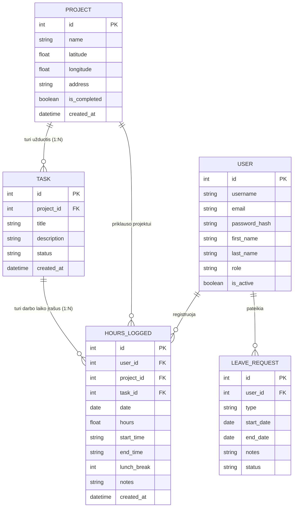
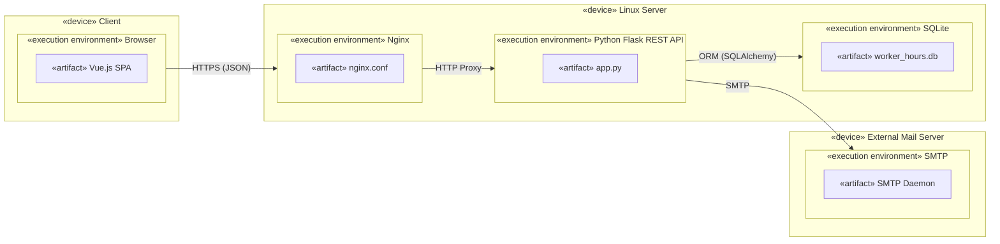

# Projekto „WorkerH“ dokumentacija (1 laboratorinis darbas)

**Modulis:** T120B165 Saityno taikomųjų programų projektavimas  
**Projekto pavadinimas:** „WorkerH“ — Darbuotojų darbo laiko ir projektų užduočių valdymo sistema  
**Darbo autorius:** Tautvydas Žilinskas  
**Darbą priėmė:** doc. prakt. Rasa Mažutienė, Lukas Navickas  
**Kaunas, 2026**

---

## Turinys
1. [Sprendžiamo uždavinio aprašymas](#1-sprendžiamo-uždavinio-aprašymas)
   - [1.1 Sistemos paskirtis](#11-sistemos-paskirtis)
   - [1.2 Funkciniai reikalavimai](#12-funkciniai-reikalavimai)
   - [1.3 Duomenų modelis (ER diagrama)](#13-duomenų-modelis-er-diagrama)
2. [Sistemos architektūra ir diegimo diagrama](#2-sistemos-architektūra-ir-diegimo-diagrama)
3. [Sąsajų specifikacija naudojant OpenAPI](#3-sąsajų-specifikacija-naudojant-openapi)
   - [3.1 15 hierarchinių REST API metodų suvestinė](#31-15-hierarchinių-rest-api-metodų-suvestinė)
   - [3.2 Papildomi sistemos API metodai](#32-papildomi-sistemos-api-metodai)
   - [3.3 OpenAPI 3.0.3 duomenų schemos (Components)](#33-openapi-303-duomenų-schemos-components)
4. [Sąsajos panaudojimo pavyzdžiai (Request / Response)](#4-sąsajos-panaudojimo-pavyzdžiai-request--response)
   - [4.1 1 lygmuo — Projektai (`Project`)](#41-1-lygmuo--projektai-project)
   - [4.2 2 lygmuo — Projekto užduotys (`Task`)](#42-2-lygmuo--projekto-užduotys-task)
   - [4.3 3 lygmuo — Darbo laiko įrašai (`WorkHours`)](#43-3-lygmuo--darbo-laiko-įrašai-workhours)
   - [4.4 Klaidų apdorojimo pavyzdžiai (`400`, `404`, `422`)](#44-klaidų-apdorojimo-pavyzdžiai-400-404-422)
5. [Aplinkos paleidimas ir demonstravimas](#5-aplinkos-paleidimas-ir-demonstravimas)
6. [Darbo išvados](#6-darbo-išvados)

---

## 1. Sprendžiamo uždavinio aprašymas

### 1.1 Sistemos paskirtis
Projekto tikslas – automatizuoti įmonės darbuotojų darbo laiko apskaitą, palengvinti atostogų ir nedarbingumo tvarkymą bei projektų užduočių valdymą.

Taikomojoje srityje realizuojamas trijų lygmenų hierarchinis ryšys:

$$\text{Projektas (Project)} \longrightarrow \text{Užduotis (Task)} \longrightarrow \text{Darbo laikas (WorkHours)}$$

Darbuotojas, gavęs administratoriaus išsiųstą kvietimą į elektroninį paštą, prisiregistruoja prie internetinės aplikacijos, kurioje gali registruoti savo darbo laiko įrašus pasirinkęs projektą ir konkrečią užduotį tame projekte. Darbo laiko įrašą sudaro: data, darbo pradžia, darbo pabaiga, pietų pertraukos trukmė (jei darbuotojas buvo pietų pertraukoje) bei komentarai apie tos dienos darbą. Sistema taip pat leidžia darbuotojams teikti atostogų prašymus, kuriuos patvirtinti arba atmesti gali vadybininkas, bei pranešti apie nedarbingumą (ligą).

### 1.2 Funkciniai reikalavimai

**Svečias galės:**
1. Peržiūrėti prisijungimo puslapį.
2. Prisijungti prie sistemos.
3. Inicijuoti slaptažodžio atkūrimą el. paštu.

**Darbuotojas (`worker`) galės:**
1. Atsijungti nuo internetinės aplikacijos.
2. Peržiūrėti projektų sąrašą bei jų adresus.
3. Peržiūrėti konkrečiam projektui priskirtas užduotis.
4. Pridėti savo darbo laiko įrašą pasirinktam projektui ir užduočiai.
5. Peržiūrėti, redaguoti ir trinti savo darbo laiko įrašus.
6. Pateikti atostogų prašymą ir pranešti apie nedarbingumą.
7. Peržiūrėti savo prašymų būsenas.

**Vadybininkas (`manager`) galės:**
1. Atlikti visus darbuotojo veiksmus.
2. Kurti, atnaujinti ir šalinti projektus.
3. Kurti, atnaujinti ir šalinti projektui priskirtas užduotis.
4. Peržiūrėti darbuotojų darbo laiko įrašus ir generuoti PDF ataskaitas.
5. Peržiūrėti darbuotojų atostogų prašymus ir juos patvirtinti arba atmesti.
6. Peržiūrėti pranešimus apie darbuotojų nedarbingumą.

**Administratorius (`admin`) galės:**
1. Siųsti kvietimus visoms rolėms (`worker`, `manager`, `admin`).
2. Valdyti naudotojų paskyras (aktyvuoti arba blokuoti).
3. Atlikti visus projektų, užduočių ir darbo laiko administravimo veiksmus.

### 1.3 Duomenų modelis (ER diagrama)



---

## 2. Sistemos architektūra ir diegimo diagrama

Sistemos sudedamosios dalys:
* **Kliento pusė (Front-End):** sukurta naudojant `Vue.js 3` (`Vite`) karkasą. Vartotojo naršyklė bendrauja su serverio puse per HTTP/HTTPS protokolą JSON formatu.
* **Serverio pusė (Back-End):** sukurta naudojant `Python Flask` mikro-karkasą ir `SQLAlchemy` ORM. Duomenų bazė – reliacinė `SQLite` (`worker_hours.db`).

Žemiau pateikta kuriamos sistemos UML diegimo diagrama. Sistemos talpinimui naudojamas Linux serveris. Kliento įrenginio naršyklė per HTTPS protokolą kreipiasi į `Nginx` serverį, kuris užklausas nukreipia į `Python Flask REST API` (`app.py`). Šis API apdoroja gautą užklausą ir per `SQLAlchemy` ORM sąsają atlieka duomenų mainus su vietine `SQLite` duomenų baze (`worker_hours.db`). Taip pat sistemos API per `SMTP` protokolą kreipiasi į išorinį el. pašto serverį naudotojų kvietimams ir slaptažodžio atstatymo laiškams siųsti.



---

## 3. Sąsajų specifikacija naudojant OpenAPI

Pilna OpenAPI 3.0.3 specifikacija yra pateikta faile [`backend/openapi.json`](backend/openapi.json) bei pasiekiama veikiančioje sistemoje:
* **Interaktyvi Swagger UI dokumentacija:** `http://localhost:5000/api/docs`
* **OpenAPI 3.0.3 JSON specifikacija:** `http://localhost:5000/api/openapi.json`

Visiems API metodams naudojamas turinio tipas `Content-Type: application/json`.

### 3.1 15 hierarchinių REST API metodų suvestinė

#### 1 lygmuo — Projektai (`Project`)
| Nr. | HTTP metodas | Maršrutas (URI) | Paskirtis | Sėkmės kodas | Klaidų kodai |
|-----|--------------|-----------------|-----------|--------------|--------------|
| **1** | `GET` | `/api/projects` | Gauti visų projektų sąrašą | `200 OK` | `401` |
| **2** | `GET` | `/api/projects/{project_id}` | Gauti konkretų projektą pagal ID | `200 OK` | `401`, `404` |
| **3** | `POST` | `/api/projects` | Sukurti naują projektą | `201 Created` | `400`, `401`, `403`, `422` |
| **4** | `PUT` | `/api/projects/{project_id}` | Atnaujinti projektą pagal ID | `200 OK` | `400`, `401`, `403`, `404`, `422` |
| **5** | `DELETE` | `/api/projects/{project_id}` | Ištrinti projektą pagal ID | `200 OK` | `401`, `403`, `404` |

#### 2 lygmuo — Užduotys (`Task`, priklausančios projektui)
| Nr. | HTTP metodas | Maršrutas (URI) | Paskirtis | Sėkmės kodas | Klaidų kodai |
|-----|--------------|-----------------|-----------|--------------|--------------|
| **6** | `GET` | `/api/projects/{project_id}/tasks` | Gauti konkretaus projekto užduočių sąrašą | `200 OK` | `401`, `404` |
| **7** | `GET` | `/api/projects/{project_id}/tasks/{task_id}` | Gauti konkrečią projekto užduotį pagal ID | `200 OK` | `401`, `404` |
| **8** | `POST` | `/api/projects/{project_id}/tasks` | Sukurti naują užduotį konkrečiame projekte | `201 Created` | `400`, `401`, `403`, `404`, `422` |
| **9** | `PUT` | `/api/projects/{project_id}/tasks/{task_id}` | Atnaujinti konkrečią projekto užduotį | `200 OK` | `400`, `401`, `403`, `404`, `422` |
| **10** | `DELETE` | `/api/projects/{project_id}/tasks/{task_id}` | Ištrinti konkrečią projekto užduotį | `200 OK` | `401`, `403`, `404` |

#### 3 lygmuo — Darbo laiko įrašai (`WorkHours`, priklausantys projekto užduočiai)
| Nr. | HTTP metodas | Maršrutas (URI) | Paskirtis | Sėkmės kodas | Klaidų kodai |
|-----|--------------|-----------------|-----------|--------------|--------------|
| **11** | `GET` | `/api/projects/{project_id}/tasks/{task_id}/hours` | Gauti užduoties darbo laiko įrašų sąrašą | `200 OK` | `401`, `404` |
| **12** | `GET` | `/api/projects/{project_id}/tasks/{task_id}/hours/{entry_id}` | Gauti konkretų darbo laiko įrašą pagal ID | `200 OK` | `401`, `403`, `404` |
| **13** | `POST` | `/api/projects/{project_id}/tasks/{task_id}/hours` | Sukurti darbo laiko įrašą projekto užduočiai | `201 Created` | `400`, `401`, `404`, `422` |
| **14** | `PUT` | `/api/projects/{project_id}/tasks/{task_id}/hours/{entry_id}` | Atnaujinti konkretų darbo laiko įrašą | `200 OK` | `400`, `401`, `403`, `404`, `422` |
| **15** | `DELETE` | `/api/projects/{project_id}/tasks/{task_id}/hours/{entry_id}` | Ištrinti konkretų darbo laiko įrašą | `200 OK` | `401`, `403`, `404` |

### 3.2 Papildomi sistemos API metodai
| HTTP metodas | Maršrutas (URI) | Paskirtis | Atsako kodai |
|--------------|-----------------|-----------|--------------|
| `POST` | `/api/auth/login` | Naudotojo prisijungimas | `200`, `400`, `401`, `403` |
| `POST` | `/api/auth/logout` | Naudotojo atsijungimas | `200` |
| `GET`, `PATCH` | `/api/auth/me` | Prisijungusio naudotojo profilio peržiūra ir atnaujinimas | `200`, `400`, `401`, `409` |
| `POST` | `/api/auth/register` | Registracija su pakvietimo žetonu | `201`, `400`, `409` |
| `POST` | `/api/auth/forgot-password` | Slaptažodžio atkūrimo inicijavimas el. paštu | `200` |
| `POST` | `/api/auth/reset-password` | Slaptažodžio pakeitimas su atkūrimo žetonu | `200`, `400`, `404` |
| `GET`, `POST` | `/api/leave` | Atostogų ir nedarbingumo prašymų sąrašas / kūrimas | `200`, `201`, `400`, `422` |
| `GET`, `DELETE` | `/api/leave/{req_id}` | Konkretaus prašymo peržiūra / atšaukimas | `200`, `403`, `404`, `422` |
| `PATCH` | `/api/leave/{req_id}/review` | Atostogų prašymo patvirtinimas arba atmetimas | `200`, `400`, `403`, `404`, `422` |
| `GET` | `/api/users` | Naudotojų sąrašas | `200`, `401`, `403` |
| `PATCH` | `/api/users/{user_id}/dismiss` | Naudotojo paskyros blokavimas | `200`, `400`, `403`, `404` |
| `PATCH` | `/api/users/{user_id}/reactivate` | Naudotojo paskyros aktyvavimas | `200`, `403`, `404` |
| `GET`, `POST` | `/api/invites` | Pakvietimų sąrašas ir naujo pakvietimo siuntimas | `200`, `201`, `400`, `403` |
| `DELETE` | `/api/invites/{invite_id}` | Pakvietimo atšaukimas | `200`, `404` |

### 3.3 OpenAPI 3.0.3 duomenų schemos (`Components`)

```yaml
openapi: 3.0.3
info:
  title: WorkerH REST API
  version: 1.0.0
components:
  schemas:
    Project:
      type: object
      properties:
        id: { type: integer, example: 1 }
        name: { type: string, example: "Verslo centro „Kauno Dokas“ renovacija" }
        latitude: { type: number, nullable: true, example: 54.9027 }
        longitude: { type: number, nullable: true, example: 23.8863 }
        address: { type: string, nullable: true, example: "Jonavos g. 7, Kaunas" }
        is_completed: { type: boolean, example: false }
    Task:
      type: object
      properties:
        id: { type: integer, example: 1 }
        project_id: { type: integer, example: 1 }
        title: { type: string, example: "Elektros instaliacijos paruošimas" }
        description: { type: string, nullable: true, example: "Kabelių vedžiojimas 2 aukšte" }
        status: { type: string, enum: [todo, in_progress, done], example: "in_progress" }
        created_at: { type: string, format: date-time }
    WorkHours:
      type: object
      properties:
        id: { type: integer, example: 1 }
        user_id: { type: integer, example: 3 }
        project_id: { type: integer, example: 1 }
        project_name: { type: string, example: "Verslo centro „Kauno Dokas“ renovacija" }
        task_id: { type: integer, example: 1 }
        task_title: { type: string, example: "Elektros instaliacijos paruošimas" }
        date: { type: string, format: date, example: "2026-10-15" }
        hours: { type: number, example: 8.0 }
        start_time: { type: string, example: "08:00" }
        end_time: { type: string, example: "17:00" }
        lunch_break: { type: integer, nullable: true, example: 60 }
        notes: { type: string, nullable: true, example: "Sumontuotos 14 paskirstymo dėžučių" }
    ErrorResponse:
      type: object
      required: [error]
      properties:
        error: { type: string, example: "Projektas nerastas" }
```

---

## 4. Sąsajos panaudojimo pavyzdžiai (Request / Response)

### 4.1 1 lygmuo — Projektai (`Project`)

#### 1. `GET /api/projects` — Gauti visų projektų sąrašą
* **Užklausa:** `GET /api/projects HTTP/1.1`
* **Atsakymas (`200 OK`, `Content-Type: application/json`):**
```json
[
  {
    "id": 1,
    "name": "Verslo centro „Kauno Dokas“ renovacija",
    "address": "Jonavos g. 7, Kaunas",
    "latitude": 54.9027,
    "longitude": 23.8863,
    "is_completed": false
  },
  {
    "id": 2,
    "name": "Saulės elektrinės montavimas Klaipėdoje",
    "address": "Pramonės g. 15, Klaipėda",
    "latitude": 55.6894,
    "longitude": 21.1793,
    "is_completed": false
  }
]
```

#### 2. `GET /api/projects/1` — Gauti konkretų projektą pagal ID
* **Užklausa:** `GET /api/projects/1 HTTP/1.1`
* **Atsakymas (`200 OK`):**
```json
{
  "id": 1,
  "name": "Verslo centro „Kauno Dokas“ renovacija",
  "address": "Jonavos g. 7, Kaunas",
  "latitude": 54.9027,
  "longitude": 23.8863,
  "is_completed": false
}
```

#### 3. `POST /api/projects` — Sukurti naują projektą (`201 Created`)
* **Užklausa:** `POST /api/projects HTTP/1.1`
```json
{
  "name": "Demonstracinis projektas",
  "address": "Studentų g. 50, Kaunas",
  "latitude": 54.9039,
  "longitude": 23.9578
}
```
* **Atsakymas (`201 Created`):**
```json
{
  "id": 5,
  "name": "Demonstracinis projektas",
  "address": "Studentų g. 50, Kaunas",
  "latitude": 54.9039,
  "longitude": 23.9578,
  "is_completed": false
}
```

#### 4. `PUT /api/projects/5` — Atnaujinti projektą (`200 OK`)
* **Užklausa:** `PUT /api/projects/5 HTTP/1.1`
```json
{
  "name": "Atnaujintas demonstracinis projektas",
  "address": "K. Baršausko g. 59, Kaunas"
}
```
* **Atsakymas (`200 OK`):**
```json
{
  "id": 5,
  "name": "Atnaujintas demonstracinis projektas",
  "address": "K. Baršausko g. 59, Kaunas",
  "latitude": 54.9039,
  "longitude": 23.9578,
  "is_completed": false
}
```

#### 5. `DELETE /api/projects/5` — Ištrinti projektą (`200 OK`)
* **Užklausa:** `DELETE /api/projects/5 HTTP/1.1`
* **Atsakymas (`200 OK`):**
```json
{
  "message": "Projektas ištrintas"
}
```

---

### 4.2 2 lygmuo — Projekto užduotys (`Task`)

#### 6. `GET /api/projects/1/tasks` — Gauti projekto užduočių sąrašą
* **Užklausa:** `GET /api/projects/1/tasks HTTP/1.1`
* **Atsakymas (`200 OK`):**
```json
[
  {
    "id": 1,
    "project_id": 1,
    "title": "Elektros instaliacijos paruošimas",
    "name": "Elektros instaliacijos paruošimas",
    "description": "Kabelių vedžiojimas 2 aukšte ir paskirstymo dėžučių montavimas",
    "status": "in_progress",
    "created_at": "2026-10-19T09:58:45.123456"
  }
]
```

#### 7. `GET /api/projects/1/tasks/1` — Gauti konkrečią projekto užduotį
* **Užklausa:** `GET /api/projects/1/tasks/1 HTTP/1.1`
* **Atsakymas (`200 OK`):**
```json
{
  "id": 1,
  "project_id": 1,
  "title": "Elektros instaliacijos paruošimas",
  "name": "Elektros instaliacijos paruošimas",
  "description": "Kabelių vedžiojimas 2 aukšte ir paskirstymo dėžučių montavimas",
  "status": "in_progress",
  "created_at": "2026-10-19T09:58:45.123456"
}
```

#### 8. `POST /api/projects/1/tasks` — Sukurti naują užduotį projekte (`201 Created`)
* **Užklausa:** `POST /api/projects/1/tasks HTTP/1.1`
```json
{
  "title": "Serverinės spintos montavimas",
  "description": "Sumontuoti 42U komutacinę spintą",
  "status": "in_progress"
}
```
* **Atsakymas (`201 Created`):**
```json
{
  "id": 10,
  "project_id": 1,
  "title": "Serverinės spintos montavimas",
  "name": "Serverinės spintos montavimas",
  "description": "Sumontuoti 42U komutacinę spintą",
  "status": "in_progress",
  "created_at": "2026-10-19T10:00:00.000000"
}
```

#### 9. `PUT /api/projects/1/tasks/10` — Atnaujinti projekto užduotį (`200 OK`)
* **Užklausa:** `PUT /api/projects/1/tasks/10 HTTP/1.1`
```json
{
  "title": "Serverinės spintos montavimas ir testavimas",
  "status": "done"
}
```
* **Atsakymas (`200 OK`):**
```json
{
  "id": 10,
  "project_id": 1,
  "title": "Serverinės spintos montavimas ir testavimas",
  "name": "Serverinės spintos montavimas ir testavimas",
  "description": "Sumontuoti 42U komutacinę spintą",
  "status": "done",
  "created_at": "2026-10-19T10:00:00.000000"
}
```

#### 10. `DELETE /api/projects/1/tasks/10` — Ištrinti projekto užduotį (`200 OK`)
* **Užklausa:** `DELETE /api/projects/1/tasks/10 HTTP/1.1`
* **Atsakymas (`200 OK`):**
```json
{
  "message": "Užduotis ištrinta"
}
```

---

### 4.3 3 lygmuo — Darbo laiko įrašai (`WorkHours`)

#### 11. `GET /api/projects/1/tasks/1/hours` — Gauti užduoties darbo laiko įrašų sąrašą
* **Užklausa:** `GET /api/projects/1/tasks/1/hours HTTP/1.1`
* **Atsakymas (`200 OK`):**
```json
[
  {
    "id": 1,
    "user_id": 3,
    "project_id": 1,
    "project_name": "Verslo centro „Kauno Dokas“ renovacija",
    "task_id": 1,
    "task_title": "Elektros instaliacijos paruošimas",
    "date": "2026-10-14",
    "hours": 8.0,
    "start_time": "08:00",
    "end_time": "17:00",
    "lunch_break": 60,
    "notes": "Išvedžioti pagrindiniai maitinimo kabeliai rytiniame korpuse"
  }
]
```

#### 12. `GET /api/projects/1/tasks/1/hours/1` — Gauti konkretų darbo laiko įrašą
* **Užklausa:** `GET /api/projects/1/tasks/1/hours/1 HTTP/1.1`
* **Atsakymas (`200 OK`):**
```json
{
  "id": 1,
  "user_id": 3,
  "project_id": 1,
  "project_name": "Verslo centro „Kauno Dokas“ renovacija",
  "task_id": 1,
  "task_title": "Elektros instaliacijos paruošimas",
  "date": "2026-10-14",
  "hours": 8.0,
  "start_time": "08:00",
  "end_time": "17:00",
  "lunch_break": 60,
  "notes": "Išvedžioti pagrindiniai maitinimo kabeliai rytiniame korpuse"
}
```

#### 13. `POST /api/projects/1/tasks/1/hours` — Sukurti darbo laiko įrašą (`201 Created`)
* **Užklausa:** `POST /api/projects/1/tasks/1/hours HTTP/1.1`
```json
{
  "date": "2026-10-01",
  "start_time": "08:00",
  "end_time": "17:00",
  "lunch_break": 60,
  "notes": "Sumontuota komutacinė spinta ir patikrintas ryšys"
}
```
* **Atsakymas (`201 Created`):**
```json
{
  "id": 8,
  "user_id": 1,
  "project_id": 1,
  "project_name": "Verslo centro „Kauno Dokas“ renovacija",
  "task_id": 1,
  "task_title": "Elektros instaliacijos paruošimas",
  "date": "2026-10-01",
  "hours": 8.0,
  "start_time": "08:00",
  "end_time": "17:00",
  "lunch_break": 60,
  "notes": "Sumontuota komutacinė spinta ir patikrintas ryšys",
  "message": "Valandos įvestos!"
}
```

#### 14. `PUT /api/projects/1/tasks/1/hours/8` — Atnaujinti darbo laiko įrašą (`200 OK`)
* **Užklausa:** `PUT /api/projects/1/tasks/1/hours/8 HTTP/1.1`
```json
{
  "date": "2026-10-01",
  "start_time": "08:00",
  "end_time": "16:30",
  "lunch_break": 30,
  "notes": "Atnaujintas komentaras ir pertraukos trukmė"
}
```
* **Atsakymas (`200 OK`):**
```json
{
  "id": 8,
  "user_id": 1,
  "project_id": 1,
  "project_name": "Verslo centro „Kauno Dokas“ renovacija",
  "task_id": 1,
  "task_title": "Elektros instaliacijos paruošimas",
  "date": "2026-10-01",
  "hours": 8.0,
  "start_time": "08:00",
  "end_time": "16:30",
  "lunch_break": 30,
  "notes": "Atnaujintas komentaras ir pertraukos trukmė"
}
```

#### 15. `DELETE /api/projects/1/tasks/1/hours/8` — Ištrinti darbo laiko įrašą (`200 OK`)
* **Užklausa:** `DELETE /api/projects/1/tasks/1/hours/8 HTTP/1.1`
* **Atsakymas (`200 OK`):**
```json
{
  "message": "Darbo laiko įrašas ištrintas"
}
```

---

### 4.4 Klaidų apdorojimo pavyzdžiai (`400`, `404`, `422`)

#### Kai resursas nerandamas (`404 Not Found`)
* **Užklausa:** `GET /api/projects/999999 HTTP/1.1`
* **Atsakymas (`404 Not Found`):**
```json
{
  "error": "Projektas nerastas"
}
```
* **Užklausa:** `GET /api/projects/1/tasks/999999 HTTP/1.1`
* **Atsakymas (`404 Not Found`):**
```json
{
  "error": "Užduotis šiame projekte nerasta"
}
```

#### Kai trūksta privalomų laukų (`400 Bad Request`)
* **Užklausa:** `POST /api/projects HTTP/1.1` su tuščiu kūnu `{}`
* **Atsakymas (`400 Bad Request`):**
```json
{
  "error": "Pavadinimas: laukas privalomas"
}
```

#### Kai pateikiami semantiškai netinkami duomenys (`422 Unprocessable Entity`)
* **Užklausa:** `POST /api/projects/1/tasks/1/hours HTTP/1.1`
```json
{
  "date": "2026-10-19",
  "start_time": "17:00",
  "end_time": "08:00"
}
```
* **Atsakymas (`422 Unprocessable Entity`):**
```json
{
  "error": "Darbo laikas turi būti teigiamas (patikrinkite pradžios, pabaigos laiką ir pietų pertrauką)"
}
```

---

## 5. Aplinkos paleidimas ir demonstravimas

### Greitas paleidimas (Windows)
Šakniniame projekto kataloge paleiskite:
```bat
start.bat
```
Skriptas paruošia virtualią aplinką, užpildo SQLite duomenų bazę prasmingais duomenimis (`backend/seed.py`), per **~2.5 s** įvykdo visų 15 API metodų ir klaidų kodų (`404`, `400`, `422`, `201`, `200`) automatinį testą (`backend/demo_test.py`) bei paleidžia Flask serverį (`http://localhost:5000`).

### Demonstravimas su Postman (~3 s)
1. Importuokite kolekciją [`postman/WorkerH_API.postman_collection.json`](postman/WorkerH_API.postman_collection.json) į **Postman**.
2. Spauskite **Run collection** -> **Run WorkerH REST API**.
3. Visi 15 hierarchinių API metodų ir papildomi `404`, `400`, `422` testai automatiškai patikrinami per ~2–4 sekundes.

### Paruošti prisijungimai duomenų bazėje
| Rolė | Vartotojo vardas | Slaptažodis |
|------|------------------|-------------|
| Administratorius (`admin`) | `admin` | `admin123` |
| Vadybininkas (`manager`) | `vadybininkas` | `vadyba123` |
| Darbuotojas (`worker`) | `jonas` | `darbas123` |
| Darbuotojas (`worker`) | `petras` | `darbas123` |
| Darbuotojas (`worker`) | `asta` | `darbas123` |

---

## 6. Darbo išvados

1. **Suprojektuota ir realizuota REST principais veikianti API sąsaja:** įgyvendintas trijų lygmenų hierarchinis ryšys (*Projektas $\rightarrow$ Užduotis $\rightarrow$ Darbo laikas*) ir visi 15 privalomų CRUD API metodų bei papildomi autentifikacijos, atostogų prašymų ir naudotojų valdymo metodai.
2. **Parengta OpenAPI 3.0.3 specifikacija:** kiekvienam API metodui aprašyti parametrai, užklausų ir atsakymų JSON schemos bei galimi HTTP būsenos kodai, taip pat integruota interaktyvi Swagger UI sąsaja (`/api/docs`).
3. **Užtikrintas korektiškas HTTP būsenos kodų ir išimčių valdymas:** API sąsaja grąžina `200 OK` sėkmingoms peržiūros, atnaujinimo ir šalinimo operacijoms, `201 Created` sukūrus naują resursą, `404 Not Found` neradus prašomo ar tėvinio hierarchinio resurso, `400 Bad Request` trūkstant privalomų laukų bei `422 Unprocessable Entity` pažeidus duomenų validacijos ar verslo logikos taisykles.
4. **Paruošta duomenų bazė ir greito demonstravimo aplinka:** panaudojant `SQLAlchemy` ORM ir `SQLite` duomenų bazę, sukurtas pradinio duomenų užpildymo skriptas (`seed.py`) bei automatinio testavimo priemonės (Postman kolekcija su testais ir `demo_test.py`), leidžiančios visus 15 API metodų ir klaidų scenarijus pademonstruoti per ~3 sekundes.
